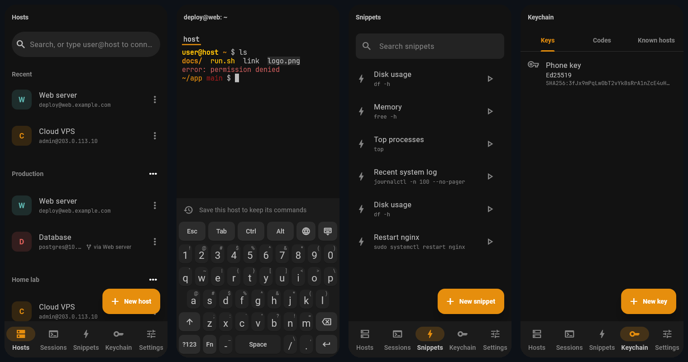
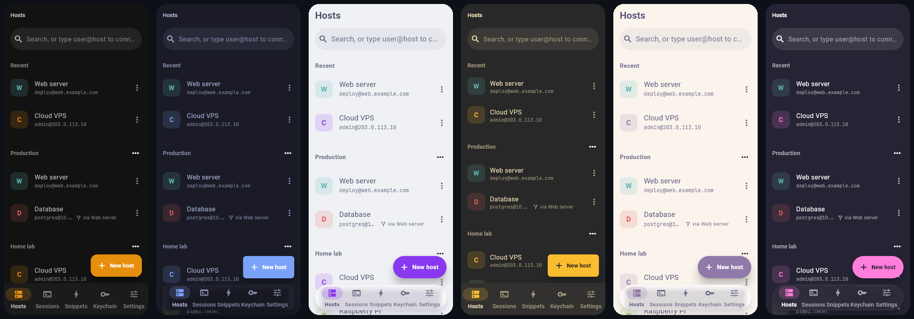
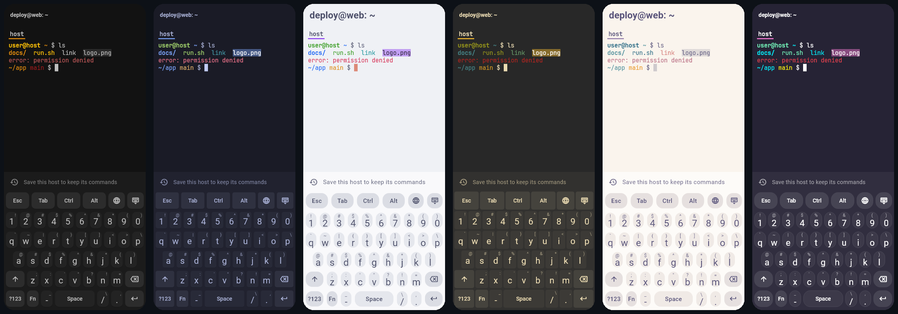
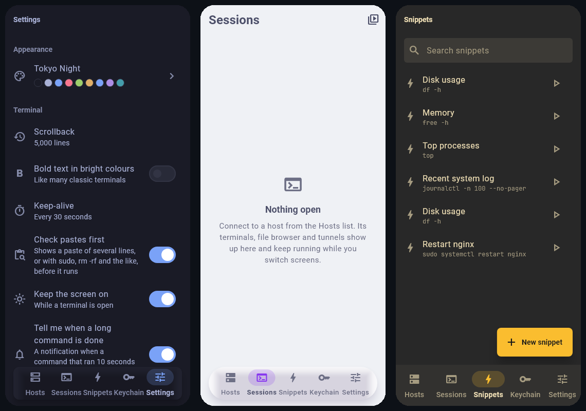

# Multiplex

An SSH client for Android with a Rust core and a Flutter interface: terminals, files, tunnels and keys in one app, with themes that change the whole look.



## Download

Get the latest APK from **[Releases](https://github.com/molotovgit/multiplex/releases/latest)** (Android 8.0 or newer, 64-bit ARM).

Every release is signed with the same key. Android only installs an update over Multiplex when it carries that signature, and the app's own updater checks the SHA-256 checksum and the signature again before it installs anything. Once installed, Multiplex tells you when a new version is out and updates itself from this page.

## Features

**Terminal**
- Fast terminal emulator written in Rust, with scrollback, colours, mouse support and copy/paste.
- Built-in keyboard made for the terminal: Esc, Tab, Ctrl, Alt, arrows and a configurable key bar. Drag along the space bar to move the cursor.
- Recent commands per host, offered as you type.
- Find in the output and the scrollback.
- Tappable links, IP addresses and file paths.
- Pinch to zoom, two-finger scrolling, and a check before pasting risky commands.
- Several terminals per connection, and two side by side in landscape.

**Connections**
- Password, key and two-factor login, with jump hosts.
- Reconnects on its own after a network drop. With "Keep session with tmux" you land back on the same screen.
- Port forwarding: local, remote and SOCKS.
- Agent forwarding (optional, per host).
- Broadcast: type once into several terminals.
- Session recording and playback (asciinema format).
- Notifications when a long command finishes in the background.
- Live server status: CPU, memory, disk, load and uptime.

**Files**
- SFTP browser with upload, download and an editor with syntax colours.
- Picture and PDF preview without saving.
- Two-pane copy between the phone and servers, or between two servers.
- Folder sync with a preview before anything changes.
- Share files from any app straight to a server.

**Keys and security**
- Generate or import SSH keys.
- One-time codes (TOTP) in the keychain, offered when a server asks.
- App lock with fingerprint, face or PIN.
- A per-host "ask for fingerprint before connecting".
- A clear warning page when a server's key changes.
- Terminals, keys and sessions are hidden from screenshots and the recent apps view.
- Everything is kept in an encrypted vault (XChaCha20-Poly1305) whose key sits in Android's secure storage. Encrypted backups use Argon2id.

**Look**
- 26 built-in themes, from Matte Black to Catppuccin, Tokyo Night, Gruvbox and Rosé Pine. Each one sets corner shapes, surfaces, navigation, fonts, keyboard and drawn backgrounds, not only colours.
- Install themes from Omarchy-style GitHub repositories, or edit a theme as text.







## Building from source

You need Flutter (stable), Rust with the Android targets, and the Android SDK and NDK.

```sh
rustup target add aarch64-linux-android
flutter pub get
flutter build apk --release --target-platform android-arm64
```

The Rust core lives in `rust/`; after changing its API, regenerate the bindings with `flutter_rust_bridge_codegen generate`.

Tests:

```sh
flutter analyze
flutter test
cd rust && cargo test
```

### Signing

Release builds are signed with the release key when it is present. The build looks for `~/.multiplex-signing/key.properties`, or the file named by the `MULTIPLEX_SIGNING` environment variable, containing `storeFile`, `storePassword`, `keyAlias` and `keyPassword`. The key is never stored in this repository. Without it, a release build is signed with the debug key, so anyone can build and run their own copy; such builds cannot update the official releases.

## Theme credits

The colour schemes are read from their published files and keep their own licences: Omarchy themes (MIT), the alacritty-theme collection (Apache-2.0), Catppuccin, Tokyo Night, Gruvbox, Nord, Rosé Pine, Everforest, Kanagawa, Dracula, Solarized, One Dark, Ayu, Night Owl, Iceberg, Oxocarbon, Synthwave '84, Vesper, Flexoki and GitHub Primer (MIT). The full list with each licence is in the app under Settings → About.

Fonts: JetBrains Mono NL Nerd Font and IBM Plex Mono, both under the SIL Open Font License.
