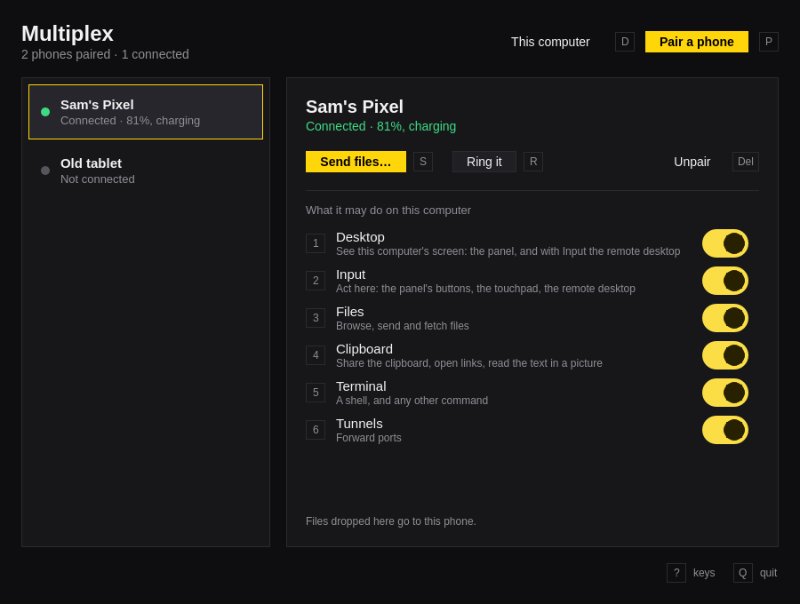
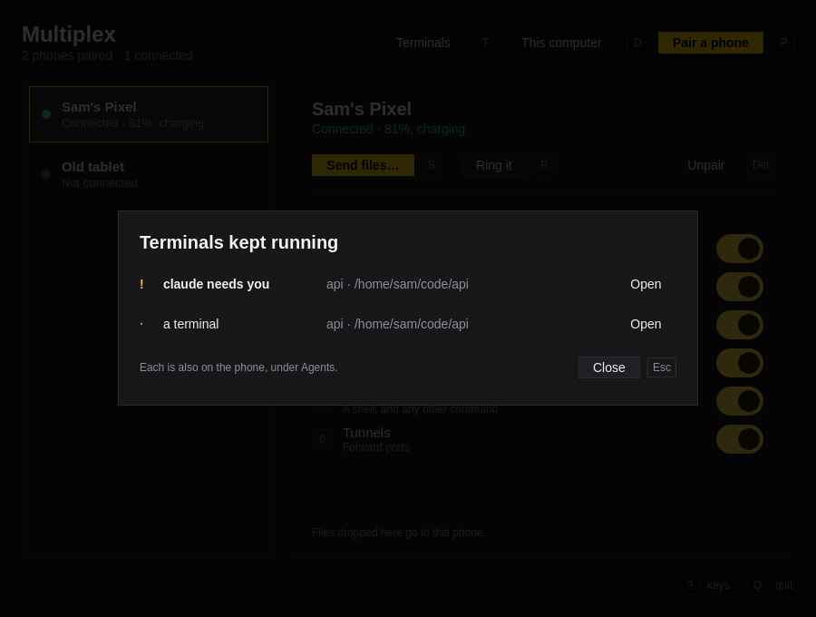
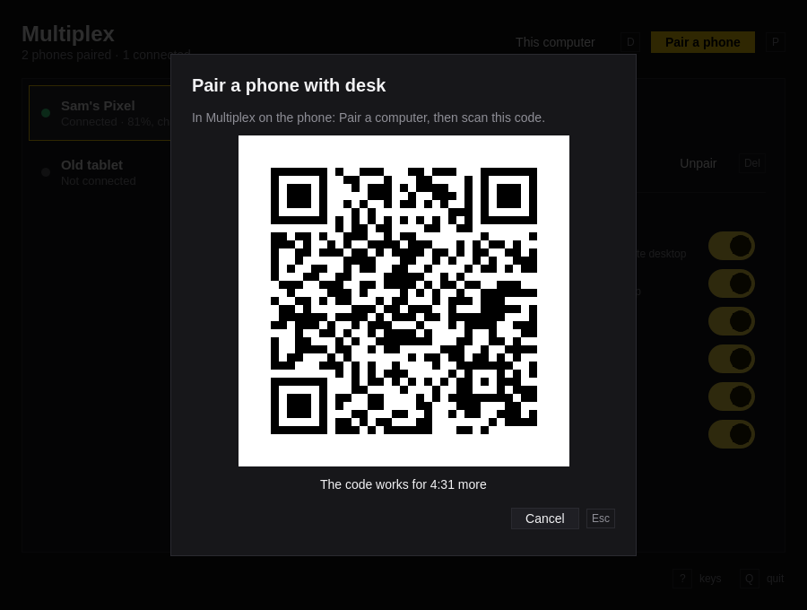
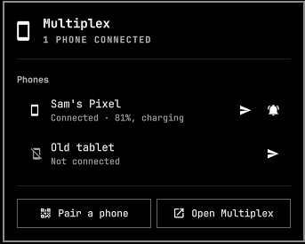

# Multiplex: one phone, one Omarchy computer

Multiplex joins an Android phone and an Omarchy computer. Everything goes over one SSH connection that the app keeps open, so nothing new is exposed; away from home it travels through Tailscale, built into the app.

## The walk-through

1. **Set up the computer once** ([1](#1-on-the-computer-omarchy)): install the package, run `multiplex setup`. That prepares SSH, the remote desktop, and sessions: from then on every terminal window you open keeps running whether or not its window is open.
2. **Pair the phone** ([2](#2-pair-the-phone)): `multiplex pair` shows a code, the app scans it.
3. **Home** on the phone is where you start. From top to bottom: the search (it finds a computer, an agent, or anything a computer offers: type "camera" or "files"); **Agents** that wait for you or finished, on any connected computer; **Continue**, the agent or terminal you were last in; then the computers.
4. **Pick up your work** ([Coding agents](#coding-agents)): an agent that needs an answer notifies the phone with its choices as buttons; its sheet shows what it wrote and takes a prompt at any time; its terminal opens at the phone's size. Close a terminal window on the computer with something running and it is still there on the phone. After a restart of the computer, agent conversations come back.
5. **A computer's page** groups everything else:
   - **Work**: Agents, Terminal, Files ([Sharing](#sharing-files-the-clipboard-links)).
   - **Control**: Desktop (the picture, below), [Panel](#the-panel-the-desktop-without-its-picture), [Touchpad](#the-touchpad-pointer-and-keys-no-picture), Extend screen.
   - **Lend the phone**: its [screen](#the-phones-screen-in-a-window), [camera](#the-phone-as-a-webcam), [microphone](#the-phone-as-a-microphone), [speaker](#the-phone-as-a-speaker), and [text from paper](#text-on-paper-to-the-computers-clipboard).
   - **Connection**: Tunnels, Status, [Wake](#waking-the-computer).
6. **From the computer** the phone is at hand too: the [Multiplex window](#the-multiplex-window) and the bar widget show it, `multiplex send` hands it a file, and it can say [yes with a fingerprint](#a-yes-from-the-phone) to `sudo`.
7. **A long press on the app's icon** goes straight to Agents, the Desktop or a Terminal on your computer.

What a phone may do on a computer is yours to limit, switch by switch: [What a phone may do](#what-a-phone-may-do).

## The remote desktop

Multiplex can show and control a Hyprland desktop (for example Omarchy) on the phone. It starts `gliff-server --stdio` over the same SSH connection it already uses.

Away from home it connects through **Tailscale, built into Multiplex**: the phone joins your tailnet from inside the app, so no Tailscale VPN app is needed. Tailscale picks the most direct path by itself: peer to peer when the networks allow it (fastest), otherwise a Tailscale relay.

## 1. On the computer (Omarchy)

Install the package and prepare the computer once:

```sh
git clone https://github.com/molotovgit/multiplex.git
cd multiplex/dist/arch
makepkg -si          # installs the `multiplex` command and the Multiplex window
multiplex setup      # run it as yourself: it asks for your password itself. `--dry-run` shows the steps first
multiplex doctor     # checks that everything is ready
multiplex bar on     # optional: Multiplex in the Omarchy bar
```

`multiplex setup` turns the SSH server on with key-only logins, opens the firewall for SSH from the home network and Tailscale only, and makes sure gliff is installed. For access away from home, also join your tailnet: `sudo tailscale up`.

## 2. Pair the phone

1. On the computer, run `multiplex pair`, or open the Multiplex window and press **Pair a phone**. Either shows a QR code for five minutes.
2. In the app: **Hosts → Pair a computer → Scan the code**. No camera? Paste the line of text shown under the code.
3. The app shows **Paired with <computer>**. Tap **Open the desktop**.

The phone has to reach the computer while pairing: be on the same Wi-Fi, or sign in to Tailscale in the app first (**Settings → Tailscale**) with the account the computer uses. Later the app picks the route by itself: Tailscale when the phone is signed in, the home-network address otherwise.

What the code does, and why it is safe to show on a screen for a few minutes:

- It carries a one-time SSH key that can do one thing, register a phone, once. `authorized_keys` holds it with `restrict`, an `expiry-time` and a forced command; it is removed the moment a phone pairs, and refused after five minutes either way.
- It carries the computer's SSH host key, so the phone's first connection already knows who it is talking to. There is no "trust this server?" question to wave through.
- The phone registers its own key. Only a well-formed ed25519 key and a plain-character name are accepted; nothing else reaches `authorized_keys`, and lines that are not Multiplex's stay untouched.
- The computer shows a notification naming the phone that paired.

`multiplex devices` lists the paired phones; `multiplex unpair "<name>"` removes one.

Building Tailscale into the app needs Go and the Android NDK. Run `native/tailscale/build-android.sh` before `flutter build apk`; builds without it work, minus Tailscale.

## The Multiplex window

`multiplex open`, or **Multiplex** in the app launcher, opens a window for the things you would otherwise type.



- The paired phones, whether each is connected, and its battery.
- **Terminals** (T): the terminals kept running, with what the agent in each is doing and which wants you; **Open** puts one in a terminal window. The same list as the phone's.

  

- **Pair a phone** (`P`) shows the pairing code for the phone's camera and waits for it. Closing the window, or **Cancel**, takes the code back at once.
- For the phone that is picked (`↑` `↓`): **Send files…** (`S` or Space; files dropped on the window go the same way), **Ring it** (`R`), **Unpair** (`Del`, asked about first), and the six switches of what it may do on this computer (`1` to `6`).
- **This computer** (`D`) lists what `multiplex doctor` checks.
- `?` shows every key; `Q` quits.



The window follows Omarchy's theme while it is open: its accent, and Hyprland's corner rounding. It is a thin layer over the command: everything it shows and does, it gets by running `multiplex`, so the two cannot disagree, and a script can do all of it too (`multiplex devices --json`, `access --json`, `doctor --json`, `pair --json`). Like the phone app (Rust with a Flutter screen), it is Rust with a QML screen, in `desktop/app`.

### In the bar

On Omarchy, `multiplex bar on` puts Multiplex in the bar; `multiplex bar off` takes it out again and leaves the bar's settings as they were. When coding agents in kept terminals wait for an answer, the bar says how many ("2 waiting"), before the phone's battery.



- The icon is a phone while one is connected, a crossed-out one when none is, and turns to the warning colour when a connected phone's battery is at 15% or less and not charging.
- A click opens the list of paired phones with their battery. Beside each: send it files, and (while it is connected) make it ring. Below: **Pair a phone** and **Open Multiplex**. Arrow keys move, Enter does, Escape closes, as in Omarchy's own panels.
- A right click opens the Multiplex window straight away; a middle click shows or hides the battery beside the icon.
- `omarchy-shell multiplex.phones toggle` opens it from a key binding.

The widget is a plugin of the Omarchy shell (`dist/omarchy/multiplex.phones`: QML, because that is what the shell runs, with its logic apart in `Model.js` and tested with `node --test`). It travels inside the `multiplex` command, which writes it to `~/.config/omarchy/plugins/` and points it at itself. It only ever runs `multiplex`, about every ten seconds for the list (which takes a millisecond). After an update of Multiplex, run `multiplex bar on` again; the Omarchy shell (seen on 4.5) keeps a widget it has loaded until it starts again, so the renewed one shows after `omarchy restart shell` or the next login.

`multiplex open --pair`, `--phone <name>` and `--send <name>` open the window at that place; the widget's buttons use them.

## The panel: the desktop without its picture

A paired computer has a **Panel** (on its card on Home, on its page, and on the bar inside the remote desktop, where it sits under the picture in portrait and beside it in landscape):

- **Workspaces** of the monitor in focus, 1 to 10. Tap one to show it; hold one to send the window in focus there. With several monitors, their names are above: tap one to give it the focus.
- **Window**: arrows move the focus to the neighbouring window (or, after a tap on the button between them, move the window itself), and Close, Full, Float, Split.
- **Open**: pinned shortcuts, at first Omarchy's menu, a terminal, the browser and the file manager. **All shortcuts** lists every key binding of the computer that has a description: search it, tap one to run it, pin the ones you want on the panel.
- **Sound**: what is playing, previous / play or pause / next, and the volume.

The panel does what the computer's own keys do. The phone runs `multiplex desk …` on the computer over the SSH connection it already has (nothing new listens on the network); that command asks Hyprland through `hyprctl`, takes the list of bindings from Omarchy's own key-binding menu, reads players over the session bus and the volume from `wpctl`. The state follows the computer by itself: switch a workspace at the desk and the phone shows it.

## The touchpad: pointer and keys, no picture

When the computer's screen is in sight (a TV across the room, the desk you are standing next to), the **Touchpad** tile turns the phone into its touchpad and keyboard. No picture is sent or decoded, so it costs a few bytes per movement and is as quick as the network.

- One finger moves the pointer (slow is exact, quick crosses the screen); a tap clicks.
- Hold still, then move, to drag. Or hold **Left click** under your thumb and move with the other hand.
- Two fingers scroll; a two-finger tap is the right button, a three-finger tap the middle one.
- The key bar has Super, Ctrl, Alt and Shift (tap: for the next key or click; double tap: locked), and the keyboard button opens Multiplex's keyboard. Text the US keyboard cannot type goes through the computer's clipboard (needs `wl-clipboard` there).

On the computer this is `multiplex input`: an ordinary Wayland program that makes a virtual pointer and a virtual keyboard (with a US keymap from `xkbcli`) and reads one short line per event from the SSH connection. A key or button cannot stay down: everything is released when the phone leaves, and when it goes quiet for a few seconds while something is held.

## Sharing: files, the clipboard, links

**From the phone.** Paired computers appear by name in Android's share sheet: pick one and the files go to it with nothing more to tap. Or share to Multiplex itself, where a paired computer is offered first:

- files: **Send to <computer>** puts them in its Downloads folder, and the computer says on its screen what arrived;
- text: **Copy to <computer>** puts it on its clipboard; a web link can also **Open on <computer>**, in its browser.

If the computer cannot be reached just then, **Send when it is next connected** keeps the files on the phone; they go by themselves the next time the phone connects to it.

Plain SSH servers are one tap further, as before (pick the server and a folder).

**From the computer.**

```sh
multiplex send report.pdf "Holiday photos/"     # a folder goes as one .tar.gz
multiplex send --to "Sam's phone" notes.txt     # with several phones paired
multiplex send                                  # what is still waiting
```

The file waits in an outbox until the phone is connected to the computer. With **Stay connected** (on by default, in the computer's **Sharing and notifications**) that is nearly always: Multiplex links the computer when the phone has started (once it was unlocked), keeps the link in the background, and keeps it when the app is swiped away, with nothing opened in it. A notification on the phone shows the open connection. Swiping the app away still closes everything else (terminals on other servers, a remote desktop). It costs some battery; switch it off per computer to link only while the app is open. Once connected, the phone fetches the file into its Multiplex downloads and shows a notification, and the computer says it was delivered. What is sent while the phone is away simply waits: the outbox is the queue.

**A newer app.** `multiplex send multiplex.apk` also updates the phone: when a received file is a newer version of Multiplex itself, signed with the same key as the one installed, the phone says so, and that computer's **Sharing and notifications** page has an **Install** button. Any other app file is just a file in the downloads.

**The clipboard.** While the phone is connected to a paired computer, text copied at the computer lands on the phone's clipboard, and text copied on the phone goes to the computer when Multiplex comes back to the front (Android only lets the app in front read the clipboard). What a password manager marks as secret is not passed on. The panel has **Phone to computer** and **Computer to phone** for doing it by hand.

Pictures go the same way: a screenshot or a copied image (PNG, JPEG, WebP or GIF, up to 8 MB) on one clipboard lands on the other, under the same switch and by the same two buttons. The computer only tells the phone that there is a picture; the phone fetches it. On the phone the picture is kept in the app's cache, one at a time, and only the app you paste it into gets to read it.

Nothing new listens on the network for any of this: the phone runs `multiplex share …` and `multiplex link` on the computer over its SSH connection, and files travel by SFTP. The computer needs `wl-clipboard` for the clipboard and `libnotify` for its notices.

## The phone, from the computer

While the phone is connected to a paired computer:

- `multiplex ring` makes the phone ring out loud, also when it is on silent, for up to 30 seconds or until its notification is tapped. For finding it.
- `multiplex devices` shows each paired phone, whether it is connected, and its battery. `multiplex devices --json` gives the same as a list (`name`, `connected`, `battery`, `charging`) for a script or a bar widget.
- When the phone rings or is in a call (also an internet call; Android 12 or later), what is playing on the computer pauses, and carries on afterwards unless you touched it meanwhile. On by default; the switch is in **Sharing and notifications**.
- **Do Not Disturb together** (off by default) silences the computer's notifications while the phone is on Do Not Disturb. The panel also has a **Do Not Disturb** chip for the computer alone.
- `multiplex sms <number> <text>` sends a text message through the phone. It is off until you switch on **Send text messages from <computer>** in that computer's **Sharing and notifications** (Android then asks for its permission once). The computer is told what became of each message: sent, or why not.
- The phone's notifications can show on the computer's screen. This is off until you switch it on for that computer (its page, **⋮ → Sharing and notifications**) and give Multiplex notification access in Android's settings, which the app opens for you. Apps appear in that screen as they post; switch one off to keep it on the phone only. Nothing is stored on either side: a notification is passed on only while the computer is connected.

## The phone's screen in a window

On a computer's page, **Phone screen** shows what is on the phone in a window on the computer: floating, in the shape of the phone's screen, in the middle of the screen. Android asks before anything is captured, every time, and shows that the screen is being shared for as long as it is. Then leave Multiplex and use the phone: the window follows. To stop, tap **Stop showing** in the app, use Android's own stop, or close the window on the computer.

- The computer needs `mpv` (`sudo pacman -S mpv`); `multiplex doctor` says whether it is there.
- The picture is the phone's screen, at most 1600 pixels on its long side, 30 pictures a second, sent as H.264 over the SSH connection that is already open. Nothing is stored on either side.
- It stays live on a slow connection. The computer tells the phone how much of the picture it has taken, so the phone knows how far behind the window is. It starts at 1.5 Mbit/s and climbs to 4 within seconds when the connection carries that. When more than about half a second of picture is on its way it asks less of the connection; at a second it stops sending, lets that arrive, and carries on from a fresh full picture at a lower bitrate (down to 0.5 Mbit/s). It stays under the bitrate that caused trouble for a minute before trying higher again.
- Turn the phone and the picture turns with it: the window takes the new shape and keeps its size (a window you made bigger stays that big).
- It is the picture only: no sound, and clicking in the window does nothing (use the phone).
- If the phone goes away without a word (out of range, the app closed), the window closes after 8 seconds.

## The phone as a webcam

On a computer's page, **Camera** makes the phone's camera a camera of the computer, named after the phone ("Sam's phone camera"). Choose the back or the front camera, hold the phone the way the picture should be, and start; Android asks for the camera the first time. The camera is there until you stop, also while Multiplex is in the background, and a notification on the phone says so.

- How programs see it depends on the computer; `multiplex doctor` says which way it will be.
  - As a PipeWire camera (needs `ffmpeg`, `gstreamer`, `gst-plugins-base` and `gst-plugin-pipewire`; no root). Programs that find cameras through PipeWire see it: browsers using the camera portal, OBS.
  - Through a `v4l2loopback` device, when one exists (needs `ffmpeg`; the kernel module is yours to install and load). Then every program that can use a webcam sees it. This way is written but has not been tried.
- 1280×720, 30 pictures a second, H.264 over the SSH connection that is already open, kept live the same way as the phone's screen above. Nothing is stored.
- The picture is turned upright for how the phone is held when you start. Turn the phone afterwards and the picture lies on its side until you stop and start again.
- The picture only: no sound.

## The phone as a microphone

On a computer's page, **Microphone** makes the phone's microphone a microphone of the computer, named after the phone ("Sam's phone microphone"). Android asks for the microphone the first time; a notification on the phone says so while it is in use, and it carries on while Multiplex is in the background.

- The computer needs `ffmpeg` and `pactl` (PipeWire with pipewire-pulse, or PulseAudio); no root. `multiplex doctor` checks.
- It does not become the computer's default input. Choose it in the program that should use it, or in the sound settings.
- 48 kHz, one channel, AAC at 64 kbit/s over the SSH connection that is already open. Nothing is stored.
- It stays current: while no program on the computer is listening the sound is dropped there, so one that starts listening hears now and not what was said a while ago. If the connection falls a second behind, sound is left out instead of arriving late.

## The phone as a speaker

On a computer's page, **Speaker** plays the computer's sound on the phone. The computer gets one more sound output, named after the phone ("Sam's phone speaker"). What is played into it is heard on the phone, wherever the phone's media sound comes out (its own speaker, its headphones), about a quarter of a second later. The phone's volume keys set how loud.

- **All of the computer's sound** (on by default): the new output becomes the computer's default output while this plays. The computer goes back to its own output when you stop, and within five seconds if the phone goes away without a word (out of range, the app closed). Switched off, only what you point at the phone's output on the computer is heard.
- The computer needs `ffmpeg` and `pactl`; no root. `multiplex doctor` checks.
- 48 kHz, two channels, AAC at 128 kbit/s over the SSH connection that is already open.
- It plays what is current: sound that arrives in a clump after a pause in the network is thrown away, not played late.
- Good for music and speech. With a film, the quarter second shows on the lips.

## Text on paper to the computer's clipboard

On a computer's page, **Scan text** opens the phone's page scanner (Google's: it finds the page's edges and straightens it). The picture goes to the computer, which reads the text in it and puts that on its clipboard. The phone shows the text too, with **Copy here too** for its own clipboard.

- A picture you already have works the same way: share it to Multiplex and choose **Copy its text to** the computer.
- The reading is done on the computer by `tesseract`, in the languages installed for it there: `sudo pacman -S tesseract tesseract-data-eng`, and one `tesseract-data-…` package for each further language (`tesseract-data-rus` for Russian, say). `multiplex doctor` lists the ones it has.
- The picture is not kept on the computer.
- The page scanner comes with Google Play services and needs no camera permission for Multiplex. On a phone without it, the shared-picture way still works.

## Coding agents

Multiplex keeps the computer's terminals running itself: a small session server (`multiplex sessions serve`, a service of your own that starts with the desktop) owns them, and a terminal window is only a viewer of one. So what runs in a terminal runs on when its window closes, and the phone can sit in front of the same terminal. Three switches set this up, each with an `-off` twin and `--dry-run`:

- `multiplex setup --terminals`: every new terminal window is a kept session (a few marked lines at the end of `~/.bashrc` or `~/.zshrc`; the file as it was is kept beside it). A window closed with something running leaves it running; closed idle, its session ends. Not over SSH, in tmux, or where `MULTIPLEX_PLAIN=1` is set; and if the server cannot take a terminal, it is a plain one.
- `multiplex setup --agents`: Claude Code tells Multiplex when it works, asks and stops, and which conversation it is in (six hooks in `~/.claude/settings.json`, beside your own). Other agents are known by their program and read off their screen.
- `multiplex setup --service`: the session server as a systemd user service.

`multiplex here` does for one terminal what the first switch does for all. `multiplex setup` on its own turns all three on along with everything else it prepares, `multiplex doctor` says how they stand, and `multiplex sessions` lists what is kept in plain lines (`multiplex sessions attach <id>` sits in front of one from any terminal).

After a restart of the computer, each terminal in which Claude Code or Codex was in a conversation comes back: a terminal in its folder, and the agent asked to carry on (`claude --resume …`, `codex resume …`). Claude Code says which conversation it is in through its hooks; Codex's is found among its own saved sessions, by the folder it was started in. A terminal with nothing running that nobody has looked at for a day is ended.

On the phone, the computer's page has an **Agents** tile. It is an inbox: every agent in every kept terminal, those that need you first, then those that finished, the busy, the idle, each with what it is doing and where. The list is always the present: the session server tells of every change and the computer tells the phone, so nothing is asked again and again (a change is on its way about 30 ms after herdr reports it).

Beside the inbox, **Everything** shows all that is kept: a workspace per folder, and in it every terminal, plain ones included. A pane with an agent opens the agent; a plain terminal opens as a terminal. The **+** on a workspace makes something new in it, in a tab of its own: a terminal, or an agent (it is started there and the phone lands in front of it). The agents that are installed come first; one that is not, on a computer that installs its tools the first time they are run (Omarchy does, through mise), says that its first start is a download. A long press on a pane closes it, asked about first. **Open a folder**, at the end of each running session, opens a folder of the computer as a new workspace: the picker starts with the folders you go to (from zoxide, where it is installed), those herdr already has open and projects in your home folder, any folder can be looked into, and the home folder and the root come last, so every folder can be reached. Then it asks what to have there: the terminal it came with, or an agent.

A tap on an agent opens it without a terminal:

- what it last wrote, read again whenever its state changes (and every two seconds while it works);
- the keys its questions take: Esc, 1, 2, 3, the arrows, Tab, Enter;
- a line to answer it or ask for more, sent as one piece with Enter;
- **Open its terminal**: that agent's pane alone in Multiplex's terminal, at the phone's own columns and rows. A terminal has the size of whoever typed in it last: back at the computer, the first key in its window gives it the window's size again.

Home itself says who wants you: under **Agents**, the agents that wait for an answer and then those that finished, from every computer the phone is connected to, each one tap from the agent itself. It is kept current while the app is in front; with the app out of sight the notification does that job.

The app remembers the agent or terminal you opened last. Home offers it first, under **Continue**: one tap connects and puts you back in front of it (or says that it is no longer running, and shows what is).

**Answering where you are.** While the phone is connected it is told when an agent starts waiting for an answer or finishes, also with the app out of sight: a notification, "Claude needs you" or "Claude is done". The session server tells the moment it happens, and the computer tells the phone. When the agent waits on a choice (a command to allow, a list to pick from), the notification says what it asks and has a button for each of its choices, in the agent's own words; press one and that is the answer. When it finished or asks in its own words, **Reply** takes an answer typed into the notification. A tap on the notification opens the agent in the app, where its sheet shows the same choices as buttons.

An answer may let a command run on your computer, so it is handled with care:

- An answer goes only to the question it was shown for. The computer reads the agent's screen again when the answer arrives; if the agent asks something else by then, went back to work, or is gone, nothing is sent and the phone says so ("That is no longer what it asks"). A notification left over from an earlier question cannot say yes to a later one.
- A choice is taken by moving the agent's own pointer to it and pressing Enter, which works in every agent's list; lists with and without numbers are read.
- The buttons work only with the phone unlocked (Android asks first; this needs Android 12 or later, older phones get the notification without buttons). What an agent asks is on the lock screen only if you let notifications show their content there.
- With Multiplex's own app lock on, notifications have no buttons: an answer waits until you open the app.
- When the agent is answered at the computer, goes on, or its pane closes, its notification is taken back.
- What an agent asks is read off its terminal, so it is told only to a phone with the Terminal switch on; a phone without the Desktop and Terminal switches is not told about agents at all.

On the computer this is `multiplex herd`:

```sh
multiplex herd state      # sessions, workspaces, tabs, panes and their agents, as one line of JSON
multiplex herd watch      # the same, and again whenever something changes
multiplex herd news       # a line when an agent starts to wait (with its question and choices) or finishes, and when one no longer does
multiplex herd do prompt <session> <pane> <text as base64>   # text and Enter for a pane's agent
multiplex herd do keys <session> <pane> esc 2 enter          # keys, by name
multiplex herd do read <session> <pane> 80                   # a pane's recent output, and what its agent asks by choice
multiplex herd do answer <session> <pane> <mark> choice 2    # take a choice, only while that question (its mark, from news or read) is asked
multiplex herd do answer <session> <pane> - text <base64>    # words for an agent that finished or asks in words ("-": no choice was shown)
multiplex herd do new-tab <session> <workspace> [<name as base64>]   # a new tab with a terminal; prints its ids
multiplex herd do new-workspace <session> <folder as base64> [<name as base64>]
multiplex herd do start <session> <pane> claude              # start an agent of a kind in a pane at its prompt
multiplex herd do close-pane <session> <pane>                # and close-tab <session> <tab>
multiplex herd kinds                                         # the agents that can be started here
multiplex herd places                                        # folders worth offering for a new workspace
multiplex herd folders <folder as base64>                    # the folders inside one
multiplex herd pane <session> <pane>                         # that pane in this terminal, at this terminal's size
```

`multiplex herd pane` works in any terminal, not only the phone's: Ctrl+\\ leaves (the terminal keeps running), `--watch` only looks.

Seeing the herd needs the Desktop or the Terminal switch (see [What a phone may do](#what-a-phone-may-do)); typing into panes and reading them needs Terminal. Ids are checked to be exactly of their shape and text travels as base64, so nothing a phone sends is ever read by a shell.

The pencil beside a workspace's name in **Everything** renames it.

**Agents outside.** An agent started in a terminal Multiplex does not keep (one opened before the switch was turned on, or inside another program) cannot be entered from anywhere else. **Everything** lists these under **Running outside Multiplex**; a tap offers to continue its latest conversation in that folder in a new terminal that can be reached (`claude --continue`, `codex resume --last`). Close the other one first: two at once on one conversation get in each other's way. On the computer: `multiplex herd outside`.

A swipe across an agent in the inbox goes straight to its terminal, past its sheet.

**Pictures for an agent.** The picture button beside the sheet's text field picks pictures on the phone, puts them on the computer (in the folder for what phones send, each under a name of its own) and writes where they are into your answer; add your words and send. Agents read a picture from its path.

## A yes from the phone

```sh
multiplex approve deploy to production && ./deploy.sh
```

`multiplex approve <what>` asks the connected phone's owner to approve something. The phone shows what is asked and wants a fingerprint, face or PIN; with the app in the background a notification asks you to open it. The command succeeds only on a yes, within a minute.

The yes cannot be faked on the computer. Each request carries a fresh random challenge, and the phone answers by signing the request (its id, the challenge, the words shown) with its own key, which never leaves the phone. The computer checks the signature against the key the phone paired with. A no, a wrong or old signature, another reason, or silence all fail.

### sudo with the phone's fingerprint

```sh
multiplex setup --sudo --dry-run     # shows what it would do, and does nothing
multiplex setup --sudo               # asks for your password once, then for a yes on the phone
multiplex setup --sudo-off           # back to the password only
```

Run these as yourself, without `sudo` in front: the command asks for your password itself where it needs it, and refuses to run as root (it would set things up for root, not for you).

After `multiplex setup --sudo`, `sudo` asks the linked phone first: "Use sudo on <computer>", a fingerprint, and it goes through. With no phone linked it asks for the password at once, as before; with a no, or no answer in 30 seconds, it asks for the password then. The phone can never refuse you sudo, only save you the typing.

This has not been tried with root yet: everything up to the last step is tested (the asking, the checking, the refusals), installing it into `sudo` is yours to do. The setup makes that safe to try. It changes `/etc/pam.d/sudo` (keeping a copy), then asks you to try `sudo` in another terminal, and puts the file back unless you answer that it worked.

What it rests on:

- The key your phone's yes is checked against is a copy in `/etc/multiplex/sudo-keys`, which only root can change. The copy in your own `authorized_keys` is not used for this: anything running as you could put another key there.
- The request is made up by the helper itself (a fresh challenge and the words shown), and the signature is checked over exactly that. Whatever changes the request or the answer on their way only makes the check fail.
- The command `sudo` runs for this has to be one that only root can change. When Multiplex is installed in your home folder, the setup puts a root-owned copy in `/usr/local/lib/multiplex/`; run the setup again after updating.
- A yes on the phone is a yes to *a* sudo on that computer, not to a particular command: `sudo` does not tell the helper what will be run. A request you did not start is one to refuse.

`multiplex doctor` says whether it is on, for which phone, and whether the root-owned copy is older than the command you now have.

Tried for real (Omarchy, a Galaxy phone on mobile data through Tailscale): `sudo true` went through 4 seconds after it was typed, on a fingerprint on the phone and without the password.

## An SSH key that lives on the phone

The phone's key can be used from the computer without ever being on it: to log in to other servers, and to sign Git commits.

```sh
multiplex agent &                                  # or: systemctl --user enable --now multiplex-agent
export SSH_AUTH_SOCK="$(multiplex agent --socket)"
multiplex key                                      # the phone's public key: put it in a server's authorized_keys
ssh you@server                                     # the phone asks: "Log in as you with this phone's key"

git config --global gpg.format ssh                 # sign commits with it
git config --global user.signingkey "key::$(multiplex key | cut -d' ' -f1,2)"
git commit -S -m "signed on the phone"             # the phone asks: "Sign a Git commit or tag …"
```

`multiplex agent` is an ordinary SSH agent. It lists the paired phones' public keys; a signing request goes to the connected phone, which shows what it is for and wants a fingerprint, face or PIN each time.

The phone does not sign whatever it is handed. It reads the request itself and signs only a real SSH login request (for its own key) or a real SSH signature request; what it shows comes from that reading, not from what the computer says. Anything else is refused without asking, so this path cannot be used to get an approval or any other signature out of the key. The computer checks the signature before handing it on.

## What a phone may do

A paired phone logs in with its own key and, by default, may do what you may. On the computer you can narrow that, per phone:

```sh
multiplex access                               # every phone and what is switched off for it
multiplex access "Sam's phone"                 # its six switches
multiplex access "Sam's phone" terminal off    # no shell, no arbitrary commands
multiplex access "Sam's phone" everything      # back to no limits
```

| Switch | Covers |
|---|---|
| `desktop` | seeing the screen: the panel's state, and (with `input`) the remote desktop; also the phone showing its own screen in a window here, lending its camera or microphone, and playing the computer's sound |
| `input` | acting on the desktop: the panel's buttons, the touchpad, and the remote desktop, which cannot show the screen without also taking keys and the pointer |
| `files` | browsing, sending and fetching files |
| `clipboard` | sharing the clipboard, opening links, reading the text in a picture onto the clipboard |
| `terminal` | a shell and any other command, including this command's own management (pairing, these switches) |
| `tunnels` | forwarding ports |

How it works: when anything is off, the phone's line in `~/.ssh/authorized_keys` gets `restrict` and a forced command, `multiplex gate`. The SSH server then runs the gate instead of what the phone asked for; the gate lets through only requests it recognises exactly (what the app sends for each feature), and everything else counts as `terminal`. So a limited phone cannot switch its own limits off. The app shows the computer's refusal as it is.

With `terminal` off, things the app does through a shell stop too: the server status page, snippets, and the keyboard opening by itself in the remote desktop (open it with its button).

## Waking the computer

A paired computer's page has a **Wake** tile: it broadcasts a Wake-on-LAN signal for the computer's network card, whose address the pairing code carried. Three things have to hold:

- the phone is on the computer's home network (the signal is a broadcast; it does not travel over Tailscale or mobile data);
- the network card listens for it: `multiplex setup` turns that on for a wired card managed by NetworkManager, and `multiplex doctor` shows whether it is on;
- the firmware (BIOS) allows waking from the network.

## Optional: up to 120 frames a second

gliff caps its stream at 60 frames a second (`MAX_FPS` in `crates/gliff-server/src/session.rs`). On a monitor faster than 60 Hz, a build with 120 cuts the wait for the next frame from about 8 ms to about 4 ms on average, for roughly 40% more data. Gliff's own rate control still lowers it on slow links.

```sh
git clone https://github.com/omacom/gliff && cd gliff
sed -i 's/^const MAX_FPS: u32 = 60;/const MAX_FPS: u32 = 120;/' crates/gliff-server/src/session.rs
cargo build --release -p gliff-server
install -m 755 target/release/gliff-server ~/.local/bin/gliff-server-fast
```

Multiplex uses `~/.local/bin/gliff-server-fast` when it exists and falls back to `gliff-server` otherwise. Delete the file to go back.

## Using it

| Gesture | Trackpad mode (default) | Direct touch |
|---|---|---|
| One finger drag | moves the pointer | drags |
| Tap | click | click where you tap |
| Two-finger tap | right-click | right-click |
| Two-finger drag | scroll | scroll |
| Hold, then drag | select or move (button held) | — (hold = right-click) |
| Three-finger tap | middle click | middle click |
| Pinch | zoom the view | zoom the view |

- **Toolbar:** phone keyboard, shortcut keys (Super, Ctrl, Alt and Shift are sticky: tap for the next key, double tap to lock), touch mode, and **More**. More has paste from phone, the launcher, terminal, close window, full screen, screen mode, text size, data saver and the speed overlay.
- **Clipboard:** text copied on the desktop lands on the phone's clipboard.
- **Typing other alphabets:** text the US layout cannot type (accents, Cyrillic, emoji) is pasted instead of typed.
- **Bluetooth or USB keyboard and mouse:** they work as they would at the desk.
